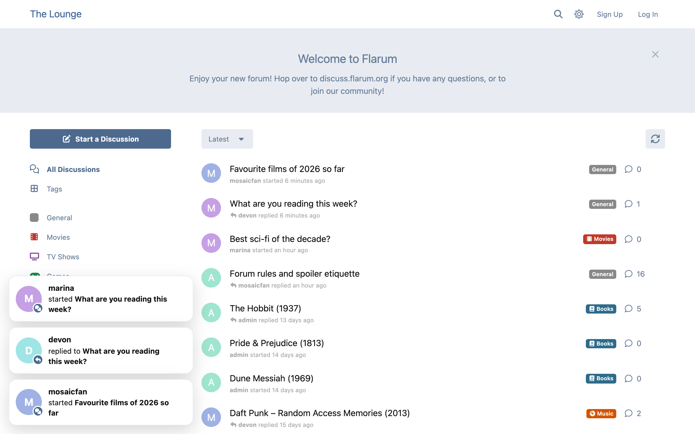
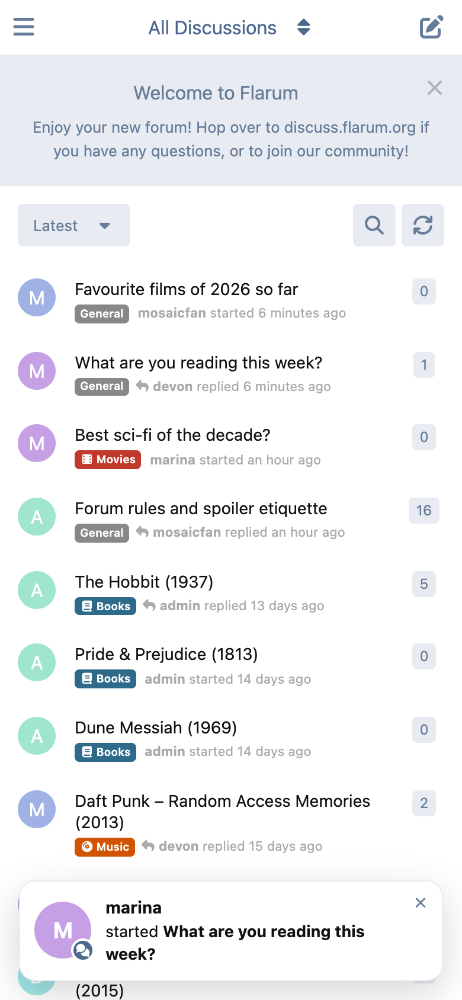
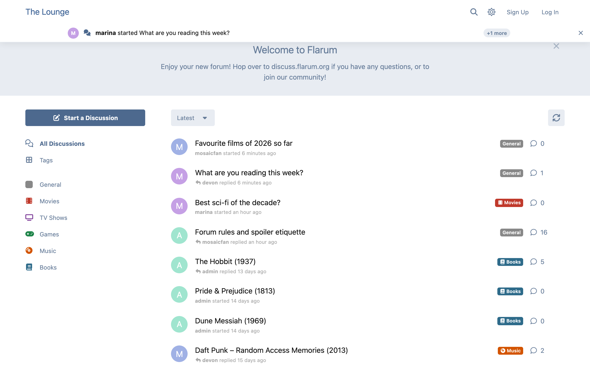
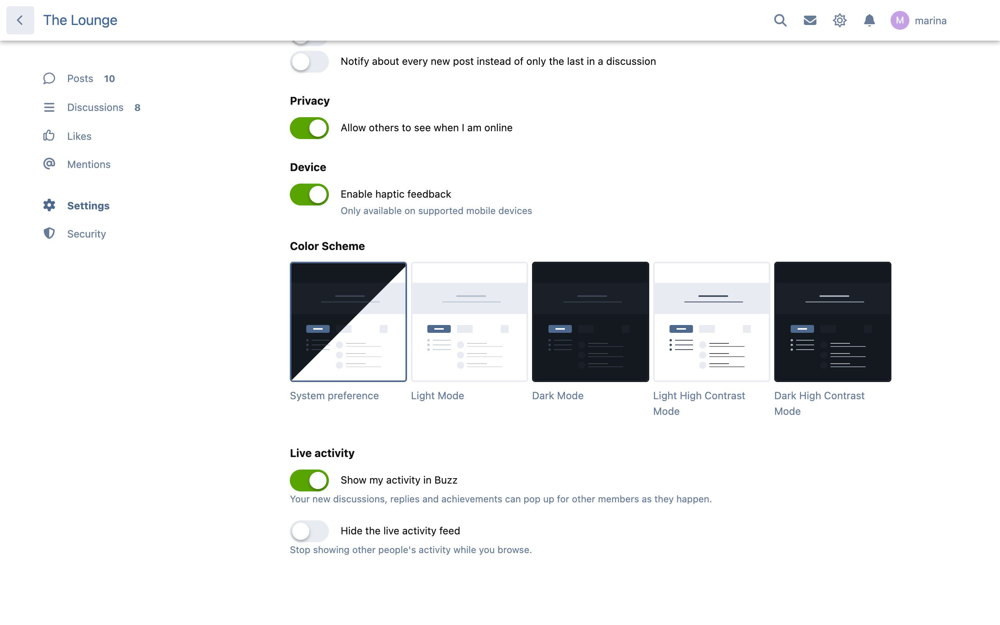

# Buzz

**A live activity feed for Flarum 2.**

New discussions, replies and members pop up across your whole forum as they happen: a small toast in a bottom corner, or a ticker under the header. With your other extensions enabled, so do badges, rank-ups, streak milestones, finished onboarding quests, passed quizzes, collection finds and store purchases. It makes a quiet forum feel alive, and a busy one feel busy.

Every visitor only ever sees what they could already see. Buzz checks that on the server, for each viewer, every time.



## What it does

- **Bottom toasts**, left or right, with your own distance from the edges. Each is a small card: a round avatar with the event's icon on its corner, the member's name, and what they did with its subject in bold ("started **What are you reading this week?**"). New ones slide up from the bottom and stack, up to the number you choose (2 by default; phones show one at a time), and each leaves on its own timer. They move up out of the way of Flarum's alerts, the composer, cookie banners, Mobile Tab's bottom bar and Parley's chat panels.
- **Top ticker** under the header, in two modes: **slide down** (one event at a time) or **marquee** (everything new scrolls past once). It finds the bottom of whatever header you run, core's or a theme's, and steps aside when the phone menu is open. A burst of the same kind becomes one line and "+4 more".
- **Hover or focus pauses** the toasts; each has its own close button.
- **Click to open.** The text opens the discussion, reply, quiz or collection; the avatar and name open the member's profile. Avatars, names and profile links can each be switched off, and names can be masked ("J…e"); a masked name never leaves your server.
- **Starts from now.** Opening a page never replays a backlog. If you like, show up to three events from the last hour for context.
- **Where it shows.** Every page or the discussion list only, and it waits while a member is writing a post.
- **Respects reduced motion.** With "reduce motion" on, the marquee becomes a still, one-at-a-time ticker and nothing slides.
- Works on the default theme and themes like Bespoke, light and dark, on desktop and phones.





### What gets broadcast

Each one is a switch on the admin page.

| Event | Needs |
| --- | --- |
| New discussion | |
| New reply | |
| New member (once their email is confirmed) | |
| Badge earned | [FoF Badges](https://github.com/FriendsOfFlarum/badges) |
| Rank-up | [Ladder](https://github.com/ernestdefoe/ladder) |
| Streak milestone | [Cadence](https://github.com/ernestdefoe/cadence) |
| Onboarding quest finished | [Onramp](https://github.com/ernestdefoe/onramp) |
| Quiz passed | [Brainstorm](https://github.com/ernestdefoe/brainstorm) |
| Item added to a collection | [Curio](https://github.com/ernestdefoe/curio) |
| Store purchase | Client Area |

An integration switches itself on when you enable that extension and off when you disable it. Buzz never requires any of them. Poll votes are never broadcast: a vote is private.

## Privacy

- **Visibility is checked for every viewer, on the server.** A reply in a tag someone can't open, a hidden or unapproved post, a private discussion, a quiz they can't see, a private collection: none of it ever reaches them. Buzz asks Flarum's own visibility rules, so tags, approval, private discussions and other extensions' rules all count.
- **Taken down means gone.** Hiding or deleting a post or discussion removes its events at once.
- **Suspended members and unconfirmed accounts are never shown.**
- **Members choose.** "Show my activity in Buzz" is in each member's settings, on by default. Switch on **Ask members first** and only members who turn it on are shown. Turning it off also takes down what was already shown.
- **Members can mute it.** "Hide the live activity feed" stops Buzz for that member.
- **Leave out groups and tags.** Staff, for example, or an off-topic tag.
- **Quizzes:** a member who keeps themselves off quiz leaderboards is never broadcast, and neither are passes on quizzes whose results are private. Quiz events are for members only.
- **Purchases are anonymous by default:** "Someone bought Parley Calls", with no name, avatar or link. Showing the buyer's name is a separate switch, off until you turn it on. Renewals and free plans are never broadcast.
- **Events expire.** They are kept for 24 hours and at most 500 (both settings), then deleted by the scheduler, or now and then by Buzz itself if you don't run one.



## Light on your forum

- **Nothing added to normal page loads.** The forum page, discussion lists and discussions run exactly the same number of queries with Buzz enabled as without it, for guests and members. The test suite measures this.
- **5 KB of JavaScript on every page** (about 2.5 KB compressed): a small poller and the settings switches. The part that draws events is fetched only when the first event arrives.
- **A cheap check.** Pages ask every 30 seconds (your setting, 10 at the least), only while the tab is visible, and back off when the server has trouble. When nothing has happened, the answer doesn't touch Buzz's table at all. When something has, it's one indexed query, the same with 10 events or 10,000.
- **Guests share one copy.** A thousand guests watching cost one query per new event, not a thousand.
- **Recording costs one insert.** Nothing else runs on the request that caused it.
- **Rate-limited:** more than 30 checks a minute from one member or address is refused.

### With Flarum Realtime

If [flarum/realtime](https://github.com/flarum/realtime) is enabled and the browser's connection to it is up, events visible to guests arrive the moment they happen: Buzz sends a signal carrying only the event's number, and each page then asks for what it may see. Nothing restricted is ever sent over the public channel; members still receive restricted events on their next check. Whenever the realtime connection is down, Buzz simply keeps checking on its own.

## For developers: add your own events

Register a type with the extender, then record events with the recorder.

```php
use Ernestdefoe\Buzz\Extend\Buzz;
use Ernestdefoe\Buzz\Feed;
use Ernestdefoe\Buzz\Recorder;
use Flarum\Extend;

return [
    (new Extend\Conditional())
        ->whenExtensionEnabled('ernestdefoe-buzz', fn () => [
            (new Buzz())->type('acme.photo', 'fas fa-camera', 'acme-photos.forum.buzz.photo', [
                // The admin switch's label (optional; defaults to the event text).
                'name' => 'acme-photos.admin.buzz.photo',
                // Viewers need this permission (optional).
                'permission' => 'acme.viewPhotos',
                // Per-viewer visibility (optional). Runs inside Buzz's one query,
                // so add a where-clause, never a query of your own.
                'scope' => fn ($query, $actor) => Feed::whereExists(
                    $query,
                    \Acme\Photos\Photo::query()->whereVisibleTo($actor),
                    'photos.id'
                ),
            ]),
        ]),
];
```

```php
// In your listener: one insert.
resolve(Recorder::class)->record('acme.photo', $user, ['title' => $photo->title], [
    'route' => ['name' => 'acme.photo', 'params' => ['id' => $photo->id]], // a forum route name
    'subject_id' => $photo->id,       // what your scope matches on
    'members_only' => false,          // true keeps it from guests
]);
```

- **The text** is your translation key. It receives `{user}` (the member's name, drawn by the browser as text or a profile link) and every value you pass. Put the key under `forum` in your locale file.
- **The link** is a route name and parameters, resolved in the browser with `app.route()`. If that route doesn't exist on the page, the event shows without a link. You can pass `url` instead: a path on this forum, starting with a single `/`.
- **The member** must be confirmed, not suspended, sharing their activity and outside excluded groups, or nothing is recorded. Pass `null` for an event with no member.
- Everything you pass is shown to everyone who may see the event, so pass only what they may see. Values are plain text: Buzz never renders HTML from them.

## Install

```
composer require ernestdefoe/buzz
```

Then enable **Buzz** in the admin panel.

## Update

```
composer update ernestdefoe/buzz
php flarum migrate
php flarum cache:clear
```

## Links

- [Source](https://github.com/ernestdefoe/buzz)
- [Report an issue](https://github.com/ernestdefoe/buzz/issues)

Free and open source under the MIT licence.

☕ [Buy me a coffee](https://buymeacoffee.com/ernestdefoe)
